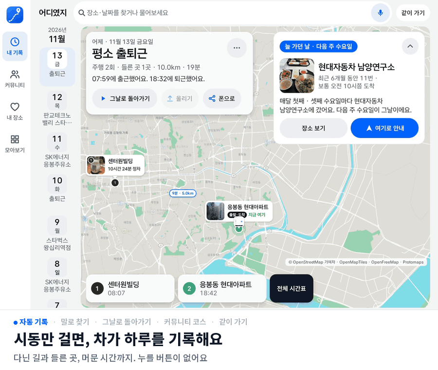

<div align="center">

# 어디였지

### 차가 기억하는 나의 모든 길

시동을 걸면 차가 다닌 길과 들른 곳을 저절로 기록합니다.<br>
나중에 "그때 거기 어디였지?" 하고 물으면, 그날을 찾아 그 길 그대로 다시 안내합니다.

<br>


<br>



<sub>Pleos Connect 에뮬레이터 실제 화면 · 시연 영상 <a href="video/v15_112s.mp4">v15 (1분 52초)</a></sub>

</div>

---

## 이런 순간을 위해 만들었습니다

> "작년 가을에 넷이서 간 바닷가 순두부집, 어디였더라?"

좋았던 곳은 대개 이름이 아니라 **상황으로** 기억납니다. 누구와, 어느 계절에, 비가 왔는지.
그런데 내비 기록에는 목적지 이름만 남고, 들렀던 곳과 지나온 길은 사라집니다.

어디였지는 차가 이미 알고 있는 것(위치, 탑승 인원, 와이퍼, 주행거리)으로 하루를 저절로 남깁니다.
운전자는 아무것도 누르지 않습니다. 필요할 때 말로 물으면 그날을 찾아 주고, 버튼 한 번으로 그 길을 다시 안내합니다.

<br>

## 심사위원 빠른 안내

| | |
|---|---|
| **앱 이름** | 어디였지 (팀 Car-pe Diem) · 패키지 `app.eodiyeotji` |
| **한 줄 소개** | 차가 알아서 기록한 길을, 말 한마디로 다시 찾고 그대로 안내받는 드라이브 기억 앱 |
| **APK (차 판 · 심사용)** | [`Car-pe-Diem_eodiyeotji_release.apk`](https://github.com/juyoung020/eodiyeotji/releases/download/submission-3/Car-pe-Diem_eodiyeotji_release.apk) (62MB) → Pleos Connect 에뮬레이터 |
| **APK (폰 판)** | [`Car-pe-Diem_eodiyeotji_phone_release.apk`](https://github.com/juyoung020/eodiyeotji/releases/download/submission-3/Car-pe-Diem_eodiyeotji_phone_release.apk) (50MB) → 일반 Android 폰 · 내린 뒤 내 차 찾기 · 사진 연결 |
| **릴리즈 페이지** | [Releases `submission-3`](https://github.com/juyoung020/eodiyeotji/releases/tag/submission-3) · 설치 안내 [`apk/`](apk/) |
| **테스트 환경** | Pleos Connect 에뮬레이터 v2.1.0 (Android API 34, x86_64, 2560 × 1440) |
| **필요한 설정** | **없습니다.** 설치만 하면 AI · 장소 검색 · 같이 가기까지 동작합니다 (클라우드 중계 서버 사용) |
| **시연 영상** | [`video/v15_112s.mp4`](video/v15_112s.mp4) (1분 52초, 1차 제출 최종본) |

### 실행하기

```powershell
adb install -r Car-pe-Diem_eodiyeotji_release.apk         # 차 판 → 에뮬레이터 (폰 판은 _phone_release.apk를 폰에)
adb shell monkey -p app.eodiyeotji -c android.intent.category.LAUNCHER 1   # 또는 앱 목록에서 "어디였지"
```

처음 켜면 위치 · 마이크 · 사진 권한을 묻습니다. 모두 허용하면 전체 기능을 볼 수 있습니다.

### 5분 둘러보기

새로 설치한 앱은 기록이 비어 있으므로, 시연용 기록을 한 번에 넣을 수 있게 해 두었습니다.

1. 첫 화면에서 **시연 기록 넣기** → 1년치 주행 기록(여행 · 출퇴근 · 출장)이 채워집니다.
2. 날짜 하나를 누릅니다 → 그날의 지도 · 경로 · 들른 곳 · 사진과 AI가 붙인 하루 제목이 보입니다.
3. 검색창에 **"작년 강릉 바다 어디였지"** (마이크로 말해도 됩니다) → 답과 그날 코스가 나오고, **이 코스로 안내**를 누르면 Pleos 내비가 안내를 시작합니다.
4. 이어서 **"거기 몇 명이서 갔어?"**, **"순두부집 빼고 안내해 줘"** → 앞 대화를 이어받아 답하고, 뺄 곳만 빼고 코스를 다시 짭니다.
5. 날짜 화면에서 **그날로 돌아가기** → 그날의 길을 3D로 다시 달립니다.
6. 장소 창에서 **같이 가기 → 새로 만들기** → 시연용 차 2대가 저절로 참여하고, 일행의 위치 · 연료 · 배터리가 실시간으로 보입니다.
7. Virtual Console에서 **기어를 D로** → 주행 화면(음성 + 큰 카드 한 장)으로 바뀝니다. 같이 가기 중에 일행이 뒤처지면 앞쪽 휴게소에서 기다리자고 제안합니다.
8. 기어를 P로 되돌리고 왼쪽 메뉴의 **모아보기** · **커뮤니티** → 출장 관리 · 업무용 운행기록부, 다른 사람이 달린 드라이브 코스와 리뷰를 봅니다.

> **참고** · 에뮬레이터에는 시동 항목이 없어 **기어 P → D**를 시동으로 씁니다. D로 바꾸면 기록이 시작되고, P로 돌아오면 그 주행이 정리됩니다.
> 주행 중에는 목록 · 글쓰기 화면이 닫히고 음성으로만 씁니다. 커뮤니티 글과 같이 가기의 시연용 차는 예시 데이터입니다.

<br>

## 언제, 무엇을 해 주나

### 출발할 때
- **자동 기록** — 시동을 걸면 기록이 시작됩니다. 시작 버튼도, 설정 화면도 없습니다.
- 다닌 길 · 머문 곳 · 탄 사람 수 · 비 온 날 · 주행거리가 저절로 남습니다.

### 운전 중 <sub>(음성 + 큰 카드 한 장)</sub>
- **말로 찾기** — 이름이나 날짜가 기억나지 않아도 "비 오던 날 넷이서 간 바다"처럼 상황으로 찾습니다.
- **한 문장 코스** — "작년 강릉 여행 그대로, 순두부집만 빼고" 한마디로 코스를 다시 짜서 내비로 보냅니다.
- **지나가면 회상** — 예전에 들른 곳 근처를 지나면 짧게 음성으로 알려 줍니다. 하루 횟수를 제한하고 내비 안내 음성과 겹치지 않게 합니다.
- **길 위 도우미** — "화장실 급해", "졸려" 한마디에 경로 앞쪽의 가까운 휴게소 · 졸음쉼터를 안내합니다.

### 도착해서 · 정차 중
- **하루 돌아보기** — 날짜별 지도 · 경로 · 들른 곳 · 사진과 AI가 정리한 하루 요약을 봅니다.
- **그날로 돌아가기** — 그날의 길을 3D로 다시 달립니다. 무드등도 그날 하늘빛으로 바뀌고, 닫으면 원래 색으로 돌아옵니다.
- **커뮤니티** — 광고 많은 블로그 대신, 실제로 달린 기록으로만 올릴 수 있는 드라이브 코스(3D 미리 달리기)와 여행 리뷰를 봅니다. 마음에 드는 코스는 그대로 안내받습니다.
- **제휴 쿠폰** — 코스 위 제휴 매장의 할인 쿠폰을 받습니다. 추천 순위는 제휴와 상관없이 실제 방문과 하트로 정합니다.

### 함께 갈 때
- **같이 가기** — 여러 차가 같은 목적지로 갈 때 일행의 위치 · 연료 · 배터리를 실시간으로 나눕니다.
- 연료나 배터리가 부족한 차가 있으면 함께 들를 주유소 · 충전소를, 일행이 뒤처지면 기다릴 휴게소를 먼저 제안합니다.
- 목적지는 모든 차에 실시간으로 공유되고, 각 차에서 **목적지로 함께 안내**를 한 번 누르면 내비가 시작됩니다.

### 일할 때
- **출장 관리** — 출장 주행을 자동으로 모아 정산서로 정리합니다.
- **업무용 운행기록부** — 주행거리계 값으로 운행기록부를 만들고 CSV로 내보냅니다.

### 차에서 내린 뒤
- **스마트폰 앱** — 차 화면의 코드나 QR로 한 번 연결하면, 내린 뒤 주차 위치까지 걸어서 내 차를 찾을 수 있습니다.
- **내 사진 연결** — 폰 갤러리 사진이 그날 들른 곳에 붙어, 하루 지도에서 어디서 찍은 사진인지 바로 보입니다.

<br>

## Pleos SDK 활용

| SDK · API | 어디에 쓰나 |
|---|---|
| **Vehicle** | 좌석 센서로 탑승 인원(누구인지는 구분하지 않음), 와이퍼로 비 온 날, 주행거리계로 운행 거리, 배터리 · 연료로 충전 필요 여부, 회상 중 무드등. 좌석 · 와이퍼 · 무드등은 차마다 지원 여부를 먼저 확인한 뒤 켭니다 |
| **NaviHelper** | 찾은 장소 · 코스를 순정 내비로 바로 안내. 경유지가 2개까지라 긴 코스는 구간으로 나누고, 도착하면 다음 구간을 이어서 요청합니다 |
| **FusedLocation** | 터널 · 지하주차장에서도 끊기지 않는 차량 위치로 경로와 머문 곳을 기록 (`isSupported()` 확인 후 사용) |
| **SpeechToText** | 운전 중 말로 묻기 (기기 안 음성 인식, 통신이 끊겨도 동작) |
| **TextToSpeech** | 답 · 회상 · 같이 가기 알림을 음성으로 |
| **AAOS Car API** | 기어 · 시동 상태는 `CarPropertyManager`, 주행 중 화면 제한은 `CarUxRestrictions` |

<br>

## 빠르고, 끊겨도 동작합니다

- **Rust가 엔진, Kotlin이 계기판** — 위치 처리 · 주행 감지 · 저장(SQLite + FTS5) · 검색 · 코스 계산은 Rust 코어가, 화면과 SDK 연결은 Kotlin(Jetpack Compose)이 맡습니다.
- 앱 첫 화면 약 0.4초, 기기 안 기억 검색은 1ms 안쪽입니다 (release 빌드, 에뮬레이터 측정).
- 기록과 검색은 기기 안에서 하므로 터널 · 지하주차장에서도 됩니다. AI · 장소 이름 · 같이 가기만 클라우드 중계 서버([`server/relay`](server/relay/))를 거치며, API 키는 서버에만 있고 APK에는 없습니다.

<br>

## 개인정보와 안전

- 기록은 기기 안에만 저장되고 기본 비공개입니다. 계정 · 로그인이 없고, 차량 번호 · 차대번호 · 기기 ID를 읽거나 보내지 않습니다.
- 공유할 때는 집 · 회사 1km 안 구간을 자동으로 가립니다. 같이 가기도 그 안에서는 내 위치를 보내지 않고, 도착하거나 12시간이 지나면 끝납니다.
- **기록 모두 지우기** 한 번으로 모든 기록을 지우고 동의를 철회할 수 있습니다.
- 주행 중에는 음성과 큰 카드 한 장만 보입니다.
- 분석 · 광고 SDK가 없고, 주행 기록을 광고나 제3자 제공에 쓰지 않습니다.

<br>

---

<details>
<summary><b>개발자용: 소스에서 빌드하기</b></summary>

```powershell
git clone https://github.com/juyoung020/eodiyeotji.git
cd eodiyeotji
./gradlew installCarRelease      # 시연용 (R8 + Rust 릴리즈 빌드)
./gradlew installCarDebug        # 개발용 (디버그 도구 포함)
./gradlew assemblePhoneDebug     # 스마트폰 판
```

- 필요한 것: JDK 17+, Android SDK 35 · NDK 27.3.13750724, Rust stable + `cargo-ndk`. 한 번에 설치: `scripts/setup-dev.ps1`, 자세히: [`docs/50_개발환경_세팅.md`](docs/50_개발환경_세팅.md)
- Rust 코어(`core-rs/`) 빌드와 Kotlin 바인딩 생성은 Gradle이 자동으로 합니다. 로직 시험: `cd core-rs && cargo test`
- 소스 빌드에서 AI · 장소 검색을 쓰려면 `local.properties`에 `RELAY_TOKEN`을 넣습니다 (중계 서버 주소는 기본값으로 들어 있음). 없으면 기기 안 검색만으로 동작합니다.
- 고음질 서버 TTS(Pleos HYBRID)는 `-PPREMIUM_TTS=true`로 빌드할 때만 켜집니다. 기본은 기기 안 음성입니다.
- 앱마켓 제출판(시연 데이터 제외): `./gradlew assembleCarRelease -PCONTEST_DEMO=false`
- 오프라인 지도 파일은 저장소 밖에서 만듭니다: `scripts/map/build-map.ps1` → `push-map.ps1`. 없으면 온라인 지도로 그립니다.
- 시연 영상 녹화: [`docs/96_시연영상_녹화.md`](docs/96_시연영상_녹화.md)

| 폴더 | 내용 |
|---|---|
| `core-rs/` | Rust 코어 (기록 · 기억 · 검색 · 비서 · 지도 데이터) |
| `app/` | Android 앱. `src/main` 공통, `src/car` Pleos 차량 판, `src/phone` 스마트폰 판 |
| `server/relay/` | 클라우드 중계 서버 (Cloudflare Worker) |
| `docs/` | 계획, 아키텍처, API 정리, 공모전 자료 |
| `video/` | 시연 · 홍보 영상 |
| `scripts/` | 에뮬레이터 실행 · 차량 조작 · 시연 경로 재생 · 지도 · 시연 녹화 |

변경 이력: [`CHANGELOG.md`](CHANGELOG.md) · 팀 작업 규칙: [`CLAUDE.md`](CLAUDE.md)

</details>

<details>
<summary><b>앱마켓 제출 시 사전 협의가 필요한 권한</b></summary>

모두 실제로 쓰며, 없거나 승인되지 않아도 그 기능만 빠지고 앱은 동작합니다.

| 권한 | 쓰는 곳 | 없을 때 |
|---|---|---|
| `pleos.car.permission.CONTROL_CAR_LIGHTS` · `CAR_LIGHTS` | 회상 중 무드등을 그날 하늘빛으로, 닫으면 원래 색 | 무드등을 건드리지 않음 |
| `pleos.car.permission.CAR_SEATS` | 탑승 인원 수 | 인원 없이 기록 |
| `pleos.car.permission.CAR_ENERGY` · `CAR_DRIVE` | 배터리 · 연료, 주행거리계 | 그 칸이 빈 채로 |
| `pleos.car.permission.CAR_WINDOWS` | 와이퍼 (비 온 날) | 비 표시 없이 |

마켓 등록 자료 초안: [`docs/market/`](docs/market/)

</details>

<details>
<summary><b>데이터 출처</b></summary>

| 데이터 | 출처 | 쓰는 곳 |
|---|---|---|
| 고속도로 휴게소 · 졸음쉼터 | 공공데이터포털 [전국휴게소정보표준데이터](https://www.data.go.kr/data/15025446/standard.do) · [전국졸음쉼터표준데이터](https://www.data.go.kr/data/15028203/standard.do), 제공 한국도로공사 ([`data/public/`](data/public/README.md)) | 길 위 도우미 · 같이 가기 휴게소 제안 |
| 지도 | OpenStreetMap 기여자 | 오프라인 지도 |
| 날씨 | Open-Meteo | 공유 코스의 그날 날씨 |

</details>

<div align="center">
<br>
<sub>현대자동차그룹 차량용 앱 개발 공모전 2026 출품작 · <a href="https://appdevchallenge.auto-hmg.io/">공모전 사이트</a></sub>
</div>
