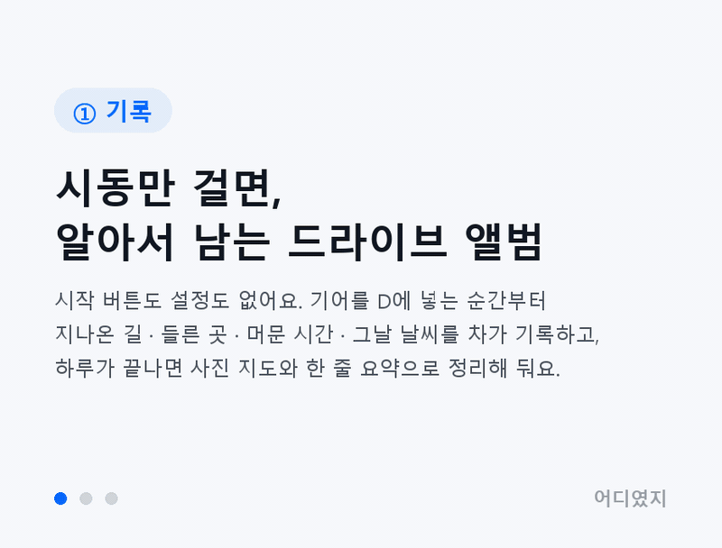
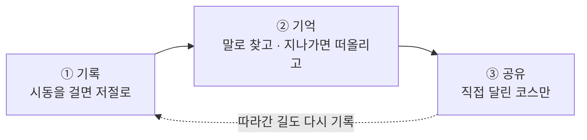

<div align="center">

# 🚗 어디였지

### "그때 거기, 어디였지?" — 차가 기억하는 나의 모든 길

시동만 걸면 차가 들른 곳과 지나온 길을 저절로 기록하고,<br>
말로 물으면 그날을 찾아 그 길 그대로 다시 안내하는 **Pleos Connect 차량용 앱**

<br>


<br>



<sub>Pleos Connect 에뮬레이터 실제 화면 · 시연 영상 모음은 [`video/`](video/)</sub>

</div>

---

## 📌 심사용 요약

| 항목 | 내용 |
|---|---|
| **앱 이름** | 어디였지 (패키지 `app.eodiyeotji`) |
| **한 줄 소개** | 차가 알아서 기록한 1년의 길을, 말 한마디로 다시 찾고 그대로 안내받는 드라이브 기억 앱 |
| **APK** | [`apk/`](apk/) 폴더 · [GitHub Releases](https://github.com/juyoung020/eodiyeotji/releases) |
| **테스트 환경** | Pleos Connect 에뮬레이터 **v2.1.0** (Android API 34, x86_64) · 기기 프로필 `Pleos_Connect_v2_0` **2560 × 1440** · 사용자 10 |
| **빌드 환경** | Gradle 8.11 · compileSdk 35 · minSdk 28 · Kotlin + Jetpack Compose · Rust 코어 (UniFFI) |
| **시연 영상** | [`video/`](video/) (버전별, 최신 v14) |

<br>

## ▶️ 실행 방법

### APK로 바로 설치

```powershell
# Pleos Connect 에뮬레이터를 켠 뒤
adb install -r apk/<APK 파일 이름>.apk
adb shell monkey -p app.eodiyeotji -c android.intent.category.LAUNCHER 1
```

- 처음 켜면 위치 · 마이크 · 사진 권한을 묻습니다. 모두 허용하면 모든 기능이 동작합니다.
- **시동(기어 P → D)을 걸면 기록이 저절로 시작**됩니다. 에뮬레이터에는 시동 항목이 없어 Virtual Console의 기어로 시연합니다.

### 소스에서 빌드

```powershell
git clone https://github.com/juyoung020/eodiyeotji.git
cd eodiyeotji
./gradlew installCarRelease      # 시연용 (R8 + Rust 릴리즈 빌드, 디버그 키 서명)
./gradlew installCarDebug        # 개발용 (시연 데이터 넣기 등 디버그 도구 포함)
```

- 필요한 것: JDK 17+, Android SDK 35 · NDK 27.3.13750724, Rust stable + `cargo-ndk` (Android 타깃 x86_64 · arm64). 한 번에 설치: `scripts/setup-dev.ps1`, 자세히: [`docs/50_개발환경_세팅.md`](docs/50_개발환경_세팅.md)
- Rust 코어(`core-rs/`) 빌드와 Kotlin 바인딩 생성은 Gradle이 자동으로 합니다.

### 필요한 설정 (선택)

비밀값은 저장소에 없습니다. `local.properties`(또는 환경 변수)에 넣으면 해당 기능이 켜지고, 없으면 그 기능만 빠진 채 동작합니다.

| 설정 | 쓰는 곳 | 없을 때 |
|---|---|---|
| `KAKAO_REST_API_KEY` | 머문 곳의 장소 이름 (카카오 로컬) | OpenStreetMap 주소 이름으로 대신 |
| `GOOGLE_PLACES_API_KEY` | 들른 곳 대표 사진 · 별점 | 사진 칸이 지도 핀 모양으로 |
| `RELAY_URL` · `RELAY_TOKEN` | 중계 서버 (`server/relay`): 카카오 · 구글 · Gemini를 키 없이 이 서버로 부른다. 넣으면 키는 APK에 들어가지 않는다 | 아래 키로 직접 |
| `LLM_BASE_URL` · `LLM_MODEL` · `LLM_API_KEY` | AI 하루 제목 · 어려운 질문 (OpenAI 호환, 기본은 중계 서버의 `/llm/v1` → Google Gemini `gemini-flash-lite-latest`, 중계가 없으면 개발 PC의 `http://10.0.2.2:8181/v1`) | 기기 안 빠른 검색으로 답합니다 (날짜 · 장소 · 사람 · 이어 묻기 · "○○ 빼고" 코스는 LLM 없이 동작) |

- AI는 클라우드 중계 서버 + Gemini로 답하므로 **개발 PC가 꺼져 있어도 심사 기기에서 동작**합니다. 개발 PC의 Qwen(`scripts/llm/`)은 로컬 개발용 선택 사항입니다 (`server/relay/README.md`)
- 오프라인 지도 파일(60MB)은 저장소 밖에서 만듭니다: `scripts/map/build-map.ps1` → `push-map.ps1`. 없으면 온라인 밑그림으로 그립니다.
- 시연용 1년치 기록: 디버그 빌드에서 `adb shell am broadcast --user 10 -n app.eodiyeotji/.record.DemoSeedReceiver`

<br>

## 🧭 무엇을 하나



| | 기능 | 이렇게 동작합니다 |
|:-:|---|---|
| ① | **자동 기록** | 기어 · 시동으로 주행을 감지해 경로 · 머문 곳 · 탄 사람(좌석) · 비(와이퍼) · 배터리 · 주행거리계를 남깁니다 |
| ① | **하루 타임라인 · 지도** | 날짜별 기록, 장소 이름 · 사진, 지도 위 경로와 내 갤러리 사진 |
| ② | **말로 찾기** | "작년 강릉 횟집 어디였지" → "거기 몇 명이서 갔어" → "거기로 안내해 줘"까지 앞 대화를 이어 받습니다 |
| ② | **한 문장 코스** | "작년 강릉 여행 그대로, 순두부집만 빼고 안내해 줘" → 그날 순서에서 뺄 곳만 빼고 다시 짠 코스를 바로 안내 |
| ② | **회상** | N년 전 오늘, 예전에 들른 곳을 지날 때 음성 안내, 그날로 돌아가기(3D 재생), 기억 지도, 달별 요약 · 올해 결산 |
| ③ | **커뮤니티** | 직접 달린 기록으로만 올라오는 드라이브 코스(3D 미리 달리기) · 여행 리뷰 · 게시판, 집 · 회사 근처는 자동으로 가림 |
| ➕ | **업무 · 생활** | 출장 자동 묶기 · 정산서, 운행기록부 CSV, 주차 위치, 차 ↔ 폰 연결 |

**주행 중에는** 음성과 큰 카드 한 장만 보이고, 목록 · 글쓰기는 정차 중에만 열립니다 (`CarUxRestrictions`).

<br>

## 🛠️ Pleos SDK 사용

| SDK | 어디에 쓰나 |
|---|---|
| **FusedLocation** | 주행 위치 묶음 기록, 예전에 들른 곳 근처 회상 |
| **Vehicle** | 좌석 탑승 인원 · 와이퍼 · 배터리 · 주행거리계 |
| **NaviHelper** | 목적지 · 경유지 이름을 기록 힌트로, 코스 안내 (경유지 2개 제한 → 구간으로 나눠 도착하면 다음 구간) |
| **SpeechToText** | 말로 묻기 (차량 마이크 음성은 이 SDK로만) |
| **TextToSpeech** | 답 · 회상 읽어 주기 (화면 위 자막과 함께) |

시동 상태 · 기어 같은 표준 차량 데이터는 AAOS 표준 `CarPropertyManager`로 읽습니다.

<br>

## 🏗️ 구조

**"Rust가 엔진, Kotlin이 계기판"** — 위치 처리 · 주행/머문 곳 감지 · 저장(SQLite + FTS5) · 검색 · 기억 비서 규칙 · 코스 계산은 모두 Rust 코어(`core-rs/`)에서 하고, Kotlin은 화면과 Pleos SDK 연결만 맡습니다. 검색은 인터넷 없이 기기 안에서 100ms 이내로 끝납니다.

| 폴더 | 내용 |
|---|---|
| `core-rs/` | Rust 코어 (기록 · 기억 · 검색 · 비서 · 지도 데이터), `cargo test`로 기기 없이 시험 |
| `app/` | Android 앱. `src/main` 공통, `src/car` Pleos 차량 판, `src/phone` 폰 판 |
| `docs/` | 계획 · 기획서 원고(`00_plan.md`), 아키텍처, API 정리, 공모전 자료(`contest/`) |
| `video/` | 시연 · 홍보 영상 버전별 |
| `scripts/` | 에뮬레이터 실행 · 차량 조작 · 시연 경로 재생 · 지도 · LLM 서버 |
| `submission/` | 제출한 접수양식(기획서) |

변경 이력: [`CHANGELOG.md`](CHANGELOG.md) · 팀 작업 규칙: [`CLAUDE.md`](CLAUDE.md)

<br>

## 🔒 개인정보 · 안전

- 기록은 기기 안에만 있고 기본 비공개입니다. 공유는 사용자가 고른 코스 · 카드만 나가며, **집 · 회사 1km 안 구간은 자동으로 가립니다.** 동승자 정보는 공유하지 않습니다.
- 회상 음성은 하루 횟수를 제한하고 내비 안내 음성과 겹치지 않게 합니다.
- 장소 사진 · 쿠폰 · 커뮤니티 글의 사용자는 시연용 예시입니다.

---

<div align="center">
<sub>현대자동차그룹 차량용 앱 개발 공모전 2026 출품작 · <a href="https://appdevchallenge.auto-hmg.io/">공모전 사이트</a></sub>
</div>
