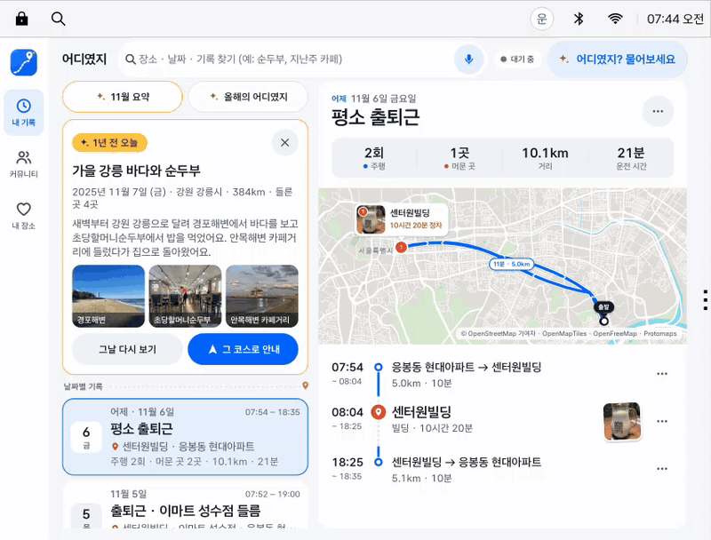
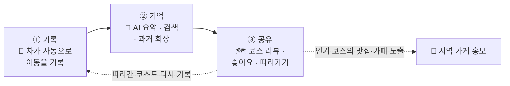

<div align="center">

# 🚗 어디였지

### "그때 거기, 어디였지?" — 차가 기억하는 나의 모든 길

**자동으로 기록하고 · AI가 요약하고 · 말로 찾고 · 지나가면 떠올리고 · 코스로 나누는**<br>
차량용 드라이브 기억 & 코스 공유 앱

<br>


<br>



<sub>Pleos Connect 에뮬레이터 실제 화면 · 정차한 곳 카드 지도 → 커뮤니티(드라이브 코스 · 여행 리뷰 · 게시판) → "여기 근처 드라이브 추천코스" → 차량 내비 안내 → "1년 전에 간 바다 어디였지?"</sub>

</div>

---

## 💡 한 문장

> **차가 알아서 모든 이동을 기록하고, AI가 "그날"을 이야기로 요약해 두면,**<br>
> **말 한마디로 그때의 길을 다시 찾고, 그 기억을 다른 사람이 따라갈 수 있는 코스로 나눌 수 있다.**

```
🎙️ "작년 여름에 바다 갔던 데 어디였지?"

🔊 "2025년 8월 14일, 네 분이 함께 강릉에 다녀오셨어요.
    횡성휴게소를 거쳐 경포해변, 점심은 초당순두부였어요. 그곳으로 안내할까요?"
```

<br>

## 🧭 서비스 구조



<br>

## ① 기록: 차에서만 알 수 있는 데이터로 남긴다

> 폰 타임라인 앱은 **"어디에 있었나"**만 압니다. 차는 **"누구와, 어떤 날씨에, 어떻게 달렸나"**까지 압니다.

| | 기록 항목 | 어떻게 아나 (Pleos SDK) | 요약에서 이렇게 쓰인다 |
|:-:|---|---|---|
| 📍 | 출발 · 경유 · 도착, 경로 | `FusedLocation` 위치 구독<br>`NaviHelper` 경로 시작 · 도착 이벤트 | 타임라인의 뼈대 |
| ⏸️ | 머문 곳 | 정차 시간 + `Vehicle.Door` 열림 | "○○식당에서 1시간 머묾" |
| 👨‍👩‍👧‍👦 | **누구와 갔나** | `Vehicle.Seat` 좌석별 탑승 (몇 명 · 어느 자리까지만 알고, **누구인지는 사용자가 태그**) | 혼자 / 둘이 / 4명 → **출근 · 데이트 · 가족여행 자동 분류** |
| 🌧️ | 날씨 | `Vehicle.Wiper` 상태, 실내외 온도 | "비 오는 날 해안도로" |
| 📏 | 거리 · 시간 | `Vehicle.Odometer` 트립 | "왕복 420km, 5시간" |
| 🔋 | 연비 · 전비 | `Vehicle.Fuel` / `EvBattery` | "이 코스 전비 6.1km/kWh" |
| 🏠 | 집 · 회사 | `NaviHelper` 즐겨찾기 HOME / OFFICE | 출퇴근 자동 분류, **공유할 때 자동으로 가림** |

<br>

## ② 기억: AI 요약 · 검색 · 과거 회상

### 📝 하루 요약
하루가 끝나면 AI가 기록을 짧은 이야기로 정리하고 태그를 붙입니다.

> **📅 2026.08.14 (금) · 👨‍👩‍👧‍👦 가족 4명 · 🌊 강릉 바다 여행**<br>
> 오전 7시 집 출발 → 횡성휴게소 → 경포해변 → 초당순두부(점심) → 안목 카페거리. 비 조금, 왕복 420km.<br>
> `#여행` `#가족` `#바다` `#맛집`

반복되는 출퇴근은 "평소 출근"으로 묶어서 타임라인을 깔끔하게 유지합니다.

### 🔍 말로 찾기
| 상황 | 방법 |
|---|---|
| 🚗 **운전 중** | `SpeechToText`로 질문 → `TextToSpeech`로 답변 → "거기로 안내해줘" → `NaviHelper`로 바로 길 안내 |
| 🅿️ **정차 중** | 날짜(년·월·일) · 장소 · 동승자 · 태그로 검색 |

> "비 오는 날 갔던 카페" · "'엄마' 태그 붙은 날 갔던 식당" · "충전하기 편했던 강원도 코스"

### 🕰️ 과거 회상
기록이 쌓일수록 가치가 커지는 기능이며, **다시 앱을 쓰게 만드는(Retention) 핵심**입니다.

| 기능 | 이렇게 동작 | 사용 API |
|---|---|---|
| 📍 **지나가면 떠오르는 기억** | 예전에 들렀던 곳 근처를 지나면<br>*"3년 전 이 길로 가족이랑 바다 갔었어요"* | `FusedLocation` 지오펜스(`addProximityAlert`) + `TextToSpeech` |
| 📆 **N년 전 오늘** | 시동을 걸면 *"1년 전 오늘은 제주 해안도로를 달렸어요"* | 날짜 매칭 + `TextToSpeech` |
| 🔁 **그날 다시 달리기** | 회상한 코스를 그대로 내비 경로로 | `NaviHelper.requestRouteWithWaypoints` |
| 👥 **함께 탄 사람의 기억** | 태그한 사람과 "같이 간 곳" 모아보기 | `Vehicle.Seat` + 사용자 태그 |
| 🎞️ **연말 결산** | *"올해 7,800km, 23곳 여행, 가장 많이 간 곳은…"* | `Vehicle.Odometer` + 기록 집계 |

<br>

## ③ 공유: 코스 커뮤니티

<table>
<tr>
<td width="50%" valign="top">

**🗺️ 코스 리뷰**
- 하루 기록을 버튼 하나로 **코스 리뷰**로 변환
- 경로 + 들른 곳 + 사진 · 메모 + AI 요약문
- 좋아요 · 저장 · **따라가기 수**로 인기 순위

</td>
<td width="50%" valign="top">

**▶️ 따라가기**
- 다른 사람 코스를 누르면 **내 내비에 바로 경로 입력**
- 🔋 **"내 차로 가능?"**: `NaviHelper.requestTrip`의 도착 시 예상 배터리 %
- 따라간 코스도 내 기록으로 다시 쌓임

</td>
</tr>
<tr>
<td valign="top">

**🔎 필터**
- 지역 · 계절 · 소요 시간
- 가족 / 연인 / 혼자 · 반려동물
- ⚡ 전기차 충전 가능 코스

</td>
<td valign="top">

**🏪 자연스러운 홍보**
- 인기 코스에 들어간 식당 · 카페가 저절로 노출
- 가게 제휴 배지 · 쿠폰으로 수익 모델로 확장

</td>
</tr>
</table>

<br>

## 🛡️ 안전 · 개인정보 설계

| | 원칙 |
|:-:|---|
| 🚗 | **주행 중에는 음성으로만** 조작합니다. 피드 보기와 리뷰 쓰기는 **정차 중에만** 됩니다 (Pleos 운전자 주의 분산 가이드 기준) |
| 🔈 | 회상 안내는 짧게 하고 하루 횟수를 제한합니다. 내비 음성과 겹치지 않게 합니다 (오디오 포커스) |
| 🔒 | 위치 기록은 기본 **비공개**입니다. 공유는 코스 단위로 직접 고를 때만 됩니다 |
| 🏠 | 공유할 때 **집 · 회사 근처 구간은 자동으로 가립니다**. 동승자 정보는 공유하지 않습니다 |

<br>

## 🏆 평가 항목별 강점

| 평가 항목 | 이 앱의 답 |
|---|---|
| 🚘 **차량특화성** | 탑승 인원 · 와이퍼 · 전비 · 정차처럼 **차에서만 아는 데이터**로 기억을 만들고, "그 길을 지날 때" 회상하며, 내비와 바로 연결됩니다 |
| ✨ **창의성** | 이동 기록을 **기억 검색과 추억 회상**으로 바꾸고, 그 기억을 **누구나 따라갈 수 있는 코스**로 만듭니다 |
| 🛠️ **기술 활용성** | **공식 SDK 5종을 모두 사용**합니다. FusedLocation(기록 · 지오펜스), NaviHelper(이벤트 · 따라가기 · 트립), Vehicle(탑승 · 와이퍼 · 주행 · 전비), STT(음성 검색), TTS(회상 안내) |
| 📈 **사업성** | 주말 드라이버 · 가족 · EV 오너가 타깃입니다. 회상과 연말 결산으로 재방문을 만들고, 가게 제휴 · 지자체 테마 코스 · 충전 사업자 제휴로 수익을 냅니다 |

<details>
<summary><b>💰 사업 모델 자세히</b></summary>

<br>

- **지역 가게 제휴 배지 · 쿠폰**: 인기 코스에 들어간 가게를 "코스 공식 맛집"으로 노출합니다 (광고임을 표시)
- **지자체 · 관광공사 테마 코스**: "가을 단풍 드라이브 10선" 같은 공식 코스
- **EV 충전 사업자 제휴**: 코스 위 충전소 추천
- **프리미엄**: 연말 결산 영상, 기록 무제한 보관
- **업무 모드 기업 구독**: 같은 기록으로 출장 보고서 · 업무용 승용차 운행기록부 초안 (차량 대수 · 사용자 수 기준). 회사가 비용을 내는 고객이라 혼자 써도 바로 가치가 있습니다
- 출시 단계에서 **위치기반서비스사업자 신고**를 마치고 서비스합니다

</details>

<details>
<summary><b>⚠️ 기술 제약과 해결 방법</b></summary>

<br>

| 제약 | 해결 |
|---|---|
| NaviHelper 경유지는 **최대 2개** (`WaypointIndex.FIRST` / `SECOND`) | 들른 곳이 많은 코스는 **구간(leg)으로 나누고**, 한 구간에 도착하면 다음 구간을 자동으로 요청합니다 |
| Vehicle · FusedLocation 지원 여부가 차종마다 다름 | `checkXxxCapabilities()` / `isSupported()`로 확인한 뒤 기능을 켭니다 |
| **LLM SDK는 공모전 공식 SDK 5종에 없음** | 자체 LLM 서버(Qwen3.5-9B, OpenAI 호환 API, `scripts/llm/`)로 하루 요약 · 질문 해석을 합니다. 설명회에서 외부 API · 인터넷 사용 허용을 확인했습니다 |
| **시동 상태는 Pleos SDK에 없음** | AAOS 표준 `IGNITION_STATE`와 기어(P 이탈)로 기록 시작 · 끝을 정합니다. 에뮬레이터엔 시동 조작이 없어 기어로 시연합니다 |

</details>

<br>

## 🗓️ 로드맵

| 단계 | 범위 |
|---|---|
| **1차 서류** | 기획서 + 화면 시안 + 가능하면 "기록 → 요약 → 검색" 시연 영상 |
| **2차 PT** | **MVP**: ① 자동 기록 ② AI 하루 요약 + 음성 검색 ③ 지오펜스 회상 안내는 확실히, ④ 코스 공유는 목록 + 따라가기만 |
| **기획서에만** | 업무 모드, 실제 방문 기준 장소 순위, 가게 제휴, 지자체 코스, 연말 결산 영상 |

<details>
<summary><b>❓ 아직 정할 것</b></summary>

<br>

- [x] 앱 이름: **어디였지**
- [x] 팀 구성 / 참가 부문: 권혁신(대표) · 김주영, 대학(원)생 부문
- [x] 팀명: **Car-pe Diem (카-르페디엠)** → 메일 제목 `[차량용 앱 개발 공모전] 어디였지_Car-pe Diem_권혁신`
- [x] LLM: 자체 서버 Qwen3.5-9B (외부 API · 인터넷 허용 확인)
- [ ] 공유 서버: 직접 구축 vs Firebase

</details>

---

<br>

## 📋 공모전 정보

> **현대자동차그룹 차량용 앱 개발 공모전 2026** · [공식 사이트](https://appdevchallenge.auto-hmg.io/) · 문의 appdevchallenge@hyundai-partners.com

<table>
<tr>
<td width="50%" valign="top">

### 📅 일정
| 날짜 | 일정 |
|---|---|
| **11.15 (일) 23:59** | 🔴 **접수 마감** |
| 11.23 (월) | 1차 서류 결과 (20팀) |
| 12.03 – 04 | 2차 최종 PT · **동작하는 앱 시연 필수** |
| 12.18 (금) | 최종 결과 (10팀) |
| 2027.02 | 현대차그룹 행사 전시 · 시상 |

</td>
<td width="50%" valign="top">

### 🏅 상금 (총 5,100만원)
| 상 | 상금 | 팀 |
|---|---|---|
| 대상 | 1,000만 | 부문별 1 |
| 최우수상 | 600만 | 부문별 1 |
| 우수상 | 400만 | 부문별 2 |
| 아이디어 특별상 | 150만 | 통합 2 |
| 숏폼 (별도) | 50만 | 1 |

</td>
</tr>
</table>

### 📌 1차 심사 기준 (배점 비공개)
| 항목 | 내용 |
|---|---|
| 차량특화성 | 모바일과 다른 차량만의 가치, 주행 · 정차 맥락과 차량 기능의 결합 |
| 창의성 | 독창성, 운전자 · 동승자 Pain Point 정의와 해결 방식 |
| 기술 활용성 | Pleos SDK · API를 핵심 기능에 활용했는지 |
| 사업성 | 타깃 고객, 예상 MAU, Retention, 확장 계획 |
| ➕ 가산점 | 시연 영상, GitHub (소스 + APK) |

👉 자세한 내용: [평가기준 정리](docs/contest/40_평가기준_정리.md)

<details>
<summary><b>📨 제출 방법</b></summary>

<br>

| 항목 | 내용 |
|---|---|
| 대상 | 대학(원)생 · 일반인 · 스타트업 / 개인 또는 팀(대표자 포함 최대 5인) |
| 필수 | 접수양식(=기획서) + 참가자 전원의 개인정보 동의 · 서명 |
| 선택 (가산점) | 시연 영상, GitHub 저장소 (소스 + `apk/팀명_앱이름_release.apk`) |
| 선택 (가산점 없음) | 숏폼 챌린지 링크 |
| 메일 제목 | `[차량용 앱 개발 공모전] 팀명(개인은 성명)_대표자명` (팀원 전원 CC). 설명회 화면은 `앱명_팀명`이라 **앱명 · 팀명 · 대표자명을 모두** 넣는다 |
| 개발 환경 | Pleos Connect SDK, Android API 28+, Gradle 8.0+, Java / Kotlin |
| 표준 차량 데이터 | 속도 · 기어 · 연료 등은 AAOS 표준 Car API로 읽음 (Pleos SDK는 특화 기능만 제공) |

</details>

<br>

## 📂 저장소 구조

<details>
<summary><b>펼쳐 보기</b></summary>

```
├── README.md          ← 이 파일 (아이디어 + 공모전 요약)
├── docs/
│   ├── 00_plan.md     ★ 백로그 · 개발 순서 · 기획서 초안 (할 일 목록 기준)
│   ├── 30_API_전체목록.md    ★ Connect SDK 6종 전체 클래스 · 메서드 (시그니처 · 설명 · 권한)
│   ├── 31_API_한눈에보기.md  ★ SDK별로 할 수 있는 것 한국어 요약 + 주의사항
│   ├── 60_앱_아키텍처.md     앱 구조 (Rust 코어 + Kotlin UI)
│   └── contest/       공모전 자료 (공식 사이트 사본 + 정리)
│       ├── 00~09_*.md     메인 + 참가 가이드 (개요/규정/일정/제출/개발환경/심사/숏폼/문의)
│       ├── 10_FAQ.md, 11_QnA.md
│       ├── 12~15_공지*.md 공지 목록 + 공지 3건 (모집공고, 설명회, 유의사항)
│       ├── 16_설명회_다시보기_정리.md ★ 10/28 온라인 설명회 영상 정리
│       ├── 20_접수양식_원문.md   접수양식(기획서) 질문 항목
│       ├── 40_평가기준_정리.md   ★ 심사 단계 · 항목 · 가산점 · 양식↔평가 대응 · 탈락 사유
│       ├── 90_이용약관.md, 91_개인정보처리방침.md
│       └── site-raw/      원본 HTML
├── refs/
│   ├── downloads/     공식 접수양식 · 동의서 (.docx)
│   ├── images/        포스터, 설명회 안내, 숏폼 예시 이미지
│   ├── pleos-docs/    Pleos 개발 문서 전체 미러 (2,007페이지)
│   │   ├── connect-sdk/  SDK API 레퍼런스 (메서드별 1파일, 예제 코드 포함)
│   │   └── guides/       에뮬레이터, 기획 · 개발 · UI 디자인 가이드, 앱마켓 심사 가이드, 릴리즈 노트
│   ├── youtube/       공모전 · Pleos 관련 영상 목록
│   └── github/        공모전 · Pleos 관련 저장소 목록
├── planning/          기획서 작성
├── src/               앱 소스 코드
├── presentation/      2차 PT 자료
└── submission/        최종 제출본
```

</details>
